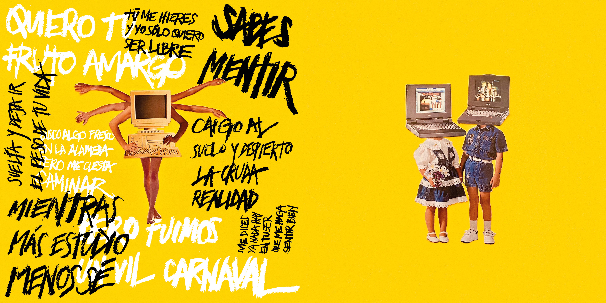

```{r}
#| label: setup
library(knitr)
```

::: {.tag-lime}
Discografía
:::

```{r}
#| label: discografia-data
discografia <- tibble::tribble(
  ~lanzamiento,           ~anio,   ~detalle,
  "Alza la Voz",          "2021",  "Álbum debut. Sencillos: El Tren, Eclipse, Destino Final",
  "Sencillos",             "2024", "Sueño Perdido, Ruido, Sin Respiración",
  "Post Digital",          "2026", "Segundo Album. Sencillos: Mi Última Reencarnación, Calles de Santiago, Huracán."
)

kable(discografia, col.names = c("Lanzamiento", "Año", "Detalle"))
```

::: {.grid}
::: {.g-col-12 .g-col-md-6}
### PostDigital *(nov. 2026)*

{fig-alt="Portada Post Digital"}

Primer sencillo PostDigital: [**"Mi Última Reencarnación"**](https://www.youtube.com/watch?v=lTOsLTuZwbw&list=RDlTOsLTuZwbw&start_radio=1)
Segundo sencillo PostDigital: [**"Calles de Santiago"**](https://www.youtube.com/watch?v=x-AghxZg5Qs&list=RDx-AghxZg5Qs&start_radio=1)
Tercer sencillo PostDigital: [**"Huracán"**](https://www.youtube.com/watch?v=lVDh_WYnE-4&list=OLAK5uy_lmkRh_9YLPjFu8k1z-8cCN2v3pXa3mcLY)
Album PostDigital: [**"Post Digital"**](https://youtube.com/playlist?list=OLAK5uy_kcjstXqanflfGNxRl1QXISj71cv9ZgFIc&si=s92-w0KE6VIn0Ask)

:::
:::
